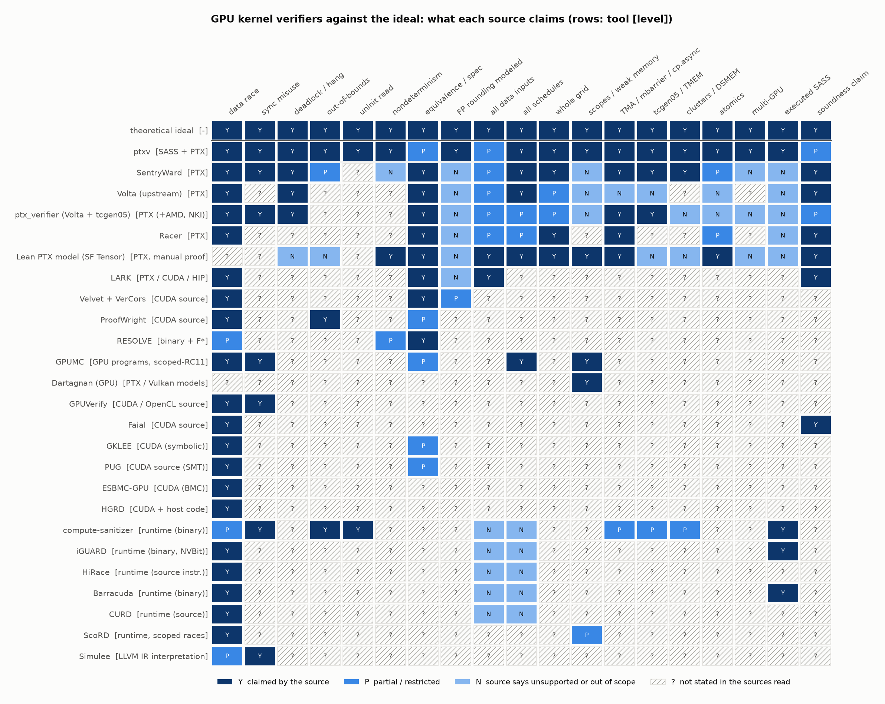
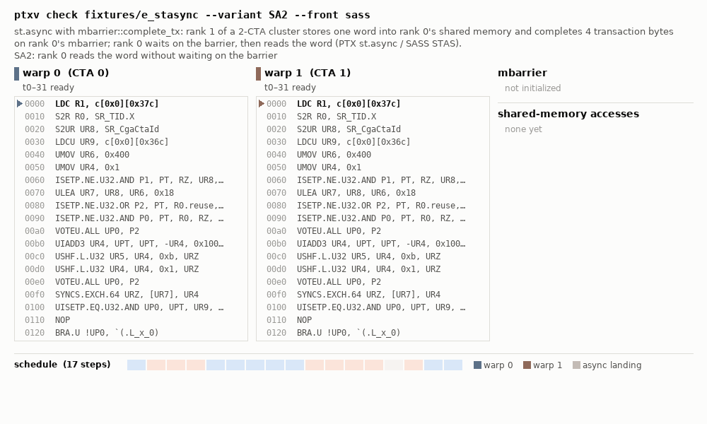
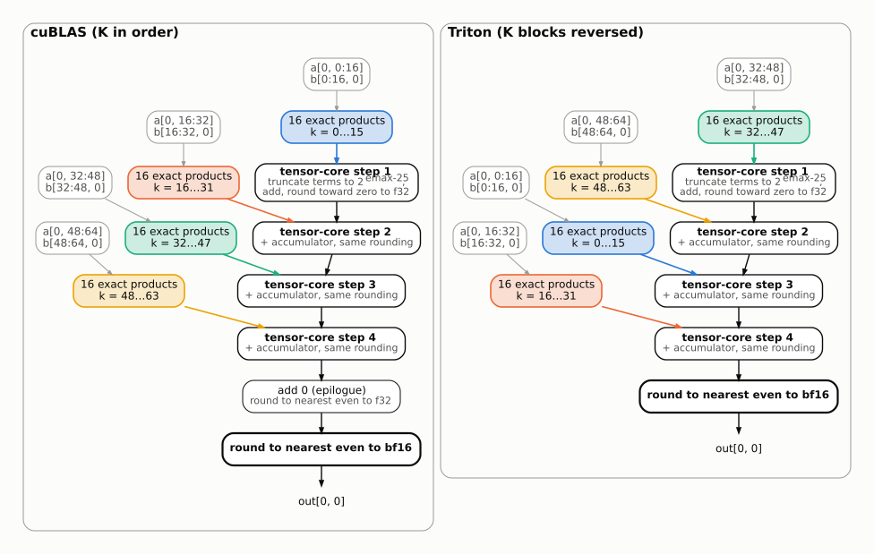

<p align="center">
  <picture>
    <source media="(prefers-color-scheme: dark)" srcset="docs/img/ptxv-icon-dark-mode.png">
    
  </picture>
</p>

# ptxv

A verifier for NVIDIA Blackwell (sm_100a / sm_103a) GPU kernels. It runs on the PTX or SASS of a captured launch and checks a kernel in two steps:

1. **Execution.** Data races, deadlocks, hangs and protocol misuse (mbarrier, TMEM, TMA, clusters, multi-GPU memory) over the schedules the hardware may pick. The result also says whether every schedule computes each output with the same operations, or which variants can occur (for example with floating-point atomics).
2. **Numerics.** Because step 1 established which operations produce each output on every schedule, they are extracted from one execution and analyzed: equivalence to a reference kernel with a proven per-output bound, and the distribution of the error under a distribution of inputs.

## Example

```python
import ptxv  # import before the first CUDA work
import torch
from ptxv import dist as D

a = torch.randn(64, 256, device="cuda", dtype=torch.bfloat16)
b = torch.randn(256, 64, device="cuda", dtype=torch.bfloat16)

with ptxv.capture() as ref:
    y_ref = a @ b

with ptxv.capture() as cand:
    y = my_matmul(a, b)

# 1. Execution: races, deadlocks and hangs over all schedules
print(cand.kernels[0].check())
# Verdict(classes=['clean'], certified, ...)

# 2. Numerics: equivalence to the reference, with a proven bound per output
eq = ptxv.compare(ref.kernels[0], cand.kernels[0])
print(eq.headline)
# PROVEN L1 (same function) for every input, |C - R| <= ... * sum|terms|

# 2. Numerics: distribution of C - R under an input distribution
#    (analyzed once, then queried per distribution)
model = ptxv.errdist_model(cand.kernels[0], ref=ref.kernels[0])
e = model(D.Normal(0, 1))
print(e.tier, e.meta["p_differ"], e.worst_case)
print(model(D.Normal(0, 1).quantize("mxf8")))
```

The same steps from the command line, on captured case directories: `ptxv check <case>`, `ptxv compare <ref> <cand>`, `ptxv errdist <equiv.toml> --inputs <spec.json>`. The end of an `errdist` report for a bf16 GEMM pair (cuBLAS against a Triton kernel that sums K in reverse), inputs ~ N(0, 1):

```
summary: tier 2 (CLT on both DAGs), agrees with the tier 3 cross-check
    P(bits differ) = 3.829e-5 (tier 3: 3.499e-5 [2.533e-5, 4.714e-5])
    error in output ulps (|k|): median 0, 99% within 0, 99.9% within 0, largest seen in tier 3: 4
    worst case (proven): |C - R| <= 2 bf16 ulps of the exact result + 3.56e-6 x sum|a_k*b_k| + 9.2e-41
```

errdist answers with an analytic central-limit model (Tier 2) when its applicability checks pass and a small Monte Carlo run (Tier 3) agrees; otherwise with Tier 3. Inputs that make every rounding exact are proven to give zero error (Tier 0). See [docs/errdist.md](docs/errdist.md).

## Build

```
source env.sh
cargo build --release
pip install -e python/
```

Requires a Rust toolchain and the CUDA 13 toolkit (`nvdisasm`, `cuobjdump`). Checking a kernel needs no GPU; capturing kernels and validating against hardware need a Blackwell GPU.

## Testing

```
cargo test --release                        # quick tier
cargo test --release -- --include-ignored   # full tier
```

The quick tier is the default: tests that take more than 30 s are marked `#[ignore = "heavy: <reason>"]` and skipped. It ran in about 6 minutes (342 s, after the build) on a 144-core machine. The full tier also runs the heavy tests (about 6 hours of test time, so run it on many cores), and the few tests ignored for other reasons. See [CONTRIBUTING.md](CONTRIBUTING.md#testing).

## Trust

Every verdict lists the modeling assumptions it relies on ([ASSUMPTIONS.md](ASSUMPTIONS.md)). The semantics of instructions, the memory model and the arithmetic units are encoded by hand and validated against GB300 hardware; they are not a formal specification. Unsupported instructions are rejected; an audit so that unsupported modifiers are also rejected, rather than ignored, is in progress.

## Related verifiers



*What each tool's own sources claim, per property. Y: claimed within the tool's stated scope, not complete coverage; P: partial or restricted; N: the source says unsupported or out of scope; ?: not stated in the sources read. Tools published before 2024 are rated from the related-work sections of later papers. The ptxv row applies the same standard to ptxv's documentation; its P cells are the open gaps: equivalence is checked against a reference kernel rather than a specification, verdicts hold for the captured inputs and launch shape, and not every proof rule has an adversarial test.*

## Design

**Execution.** The SASS (or PTX) of the captured launch is lifted to one IR, including the SASS scoreboard and dependency-barrier bits. A simulator holds every warp, async unit (TMA, tcgen05, remote stores) and barrier as explicit state, and an explorer with partial-order reductions visits the schedules the hardware may pick. Along each schedule, vector clocks track the happens-before relation of the PTX memory model (barriers, mbarrier phases, release/acquire with scopes, proxy fences, async completions). Two conflicting accesses left unordered by it, and not both morally strong, are a race; a state from which nothing can move before all threads exit is a deadlock. By the model's DRF-SC property, a race-free result under interleavings holds for the weak model (for the async, tcgen05 and tensormap proxies this is assumed; see ASSUMPTIONS.md). When every barrier phase, wait and value is determined, a certificate (E-WELLSYNC) shows that one run decides all schedules, and replaces the search. Each finding carries the schedule that reaches it.



*fixtures/e_stasync, variant SA2: CTA 0 reads a word that CTA 1 stores into its shared memory (STAS) without waiting on the mbarrier; ptxv's witness replayed step by step, ending on the verdict and on the certified `good` variant.*

**Numerics.** Step 1 also establishes that every schedule computes each output with the same operations in the same order, or lists the variants (e.g. floating-point atomics). The numerics DAG of one execution is then the kernel's dataflow on every schedule: leaves are input elements; nodes are tensor-core steps, adds, FMAs and roundings, each with a model of its arithmetic (the tensor-core models are calibrated on GB300). errdist evaluates the DAG under an input distribution: Tier 0 proves the error is zero when every rounding is exact on the inputs' lattice; Tier 2 propagates per-node rounding laws with a central-limit model, and is reported when its applicability checks pass and Tier 3 agrees; Tier 3 is Monte Carlo through the DAG, bit-exact per sample. For a pair such as the one below, the two DAGs share their terms and differ in the order of the roundings, which is where the outputs differ.



*The DAG of out[0, 0] for a 64×64×64 bf16 GEMM (fixtures/c_equiv_mm_bf16): cuBLAS, and a Triton kernel that walks its two K blocks in reverse. The same 64 products enter the f32 accumulator in a different order.*

Details: [docs/design.md](docs/design.md) (§0, §3) and [docs/errdist.md](docs/errdist.md) (§4, §5).

## Documentation

| topic | doc |
|---|---|
| capturing kernels from PyTorch, Triton, CuTeDSL | [docs/capture.md](docs/capture.md) |
| Python API | [docs/python.md](docs/python.md) |
| execution checking: semantics, search, certificates | [docs/design.md](docs/design.md), [docs/sass-ctrl.md](docs/sass-ctrl.md), [docs/rung0.md](docs/rung0.md) – [docs/rung4.md](docs/rung4.md) |
| equivalence of two kernels | [docs/compare.md](docs/compare.md), [docs/equiv-reassoc.md](docs/equiv-reassoc.md), [docs/equiv-mma.md](docs/equiv-mma.md), [docs/equiv-elementwise.md](docs/equiv-elementwise.md) |
| error distributions (`errdist`) | [docs/errdist.md](docs/errdist.md) |
| low-precision formats (fp8, fp4, MX, NVFP4) | [docs/lowp.md](docs/lowp.md) |
| torch.compile vs eager | [docs/compile-vs-eager.md](docs/compile-vs-eager.md) |
| SASS instruction coverage | [docs/lift-coverage.md](docs/lift-coverage.md) |
| multi-node exploration | [docs/multinode.md](docs/multinode.md) |
| JSON output | [docs/json.md](docs/json.md) |
| fixtures that need regeneration (third-party kernels) | [docs/fixtures.md](docs/fixtures.md) |
| roadmap and known gaps | [ROADMAP.md](ROADMAP.md), [BUGS.md](BUGS.md) |

## License

BSD-3-Clause (proposed, subject to Meta open source review); see [LICENSE](LICENSE). Contributing: [CONTRIBUTING.md](CONTRIBUTING.md).
