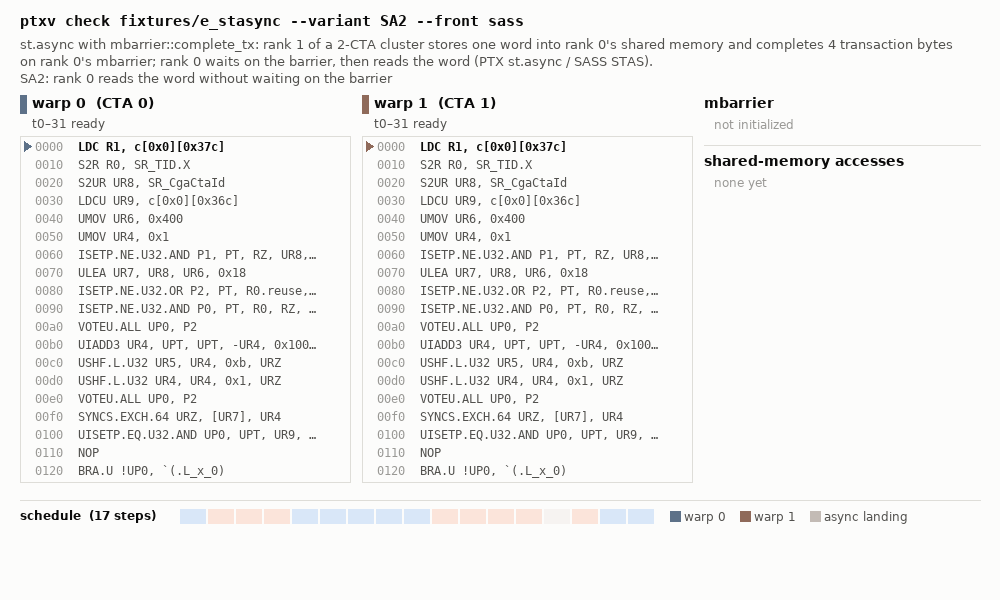
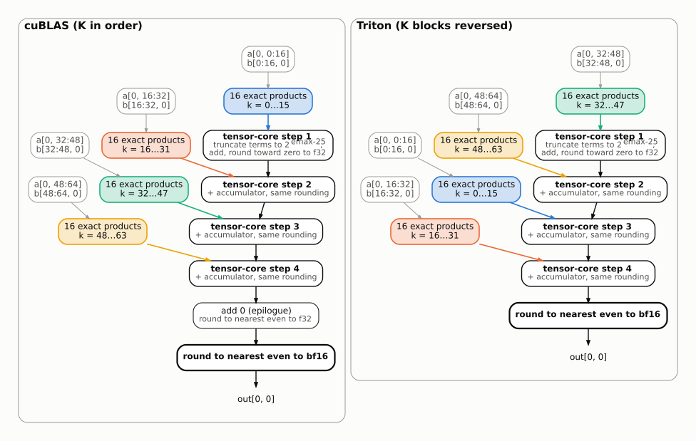

## Design

**Execution.** The SASS (or PTX) of the captured launch is lifted to one IR, including the SASS scoreboard and dependency-barrier bits. A simulator holds every warp, async unit (TMA, tcgen05, remote stores) and barrier as explicit state, and an explorer with partial-order reductions visits the schedules the hardware may pick. Along each schedule, vector clocks track the happens-before relation of the PTX memory model (barriers, mbarrier phases, release/acquire with scopes, proxy fences, async completions). Two conflicting accesses left unordered by it, and not both morally strong, are a race; a state from which nothing can move before all threads exit is a deadlock. By the model's DRF-SC property, a race-free result under interleavings holds for the weak model. When every barrier phase, wait and value is determined, a certificate (E-WELLSYNC) shows that one run decides all schedules, and replaces the search. Each finding carries the schedule that reaches it.

*fixtures/e_stasync, variant SA2: CTA 0 reads a word that CTA 1 stores into its shared memory (STAS) without waiting on the mbarrier; ptxv's witness replayed step by step, ending on the verdict and on the certified `good` variant.*

**Numerics.** Step 1 also establishes that every schedule computes each output with the same operations in the same order, or lists the variants (e.g. floating-point atomics). The numerics DAG of one execution is then the kernel's dataflow on every schedule: leaves are input elements; nodes are tensor-core steps, adds, FMAs and roundings, each with a model of its arithmetic (the tensor-core models are calibrated on GB300). errdist evaluates the DAG under an input distribution: Tier 0 proves the error is zero when every rounding is exact on the inputs' lattice; Tier 2 propagates per-node rounding laws with a central-limit model, and is reported when its applicability checks pass and Tier 3 agrees; Tier 3 is Monte Carlo through the DAG, bit-exact per sample. For a pair such as the one below, the two DAGs share their terms and differ in the order of the roundings, which is where the outputs differ.

*The DAG of out[0, 0] for a 64×64×64 bf16 GEMM (fixtures/c_equiv_mm_bf16): cuBLAS, and a Triton kernel that walks its two K blocks in reverse. The same 64 products enter the f32 accumulator in a different order.*

Details: [docs/design.md](docs/design.md) (§0, §3) and [docs/errdist.md](docs/errdist.md) (§4, §5).
