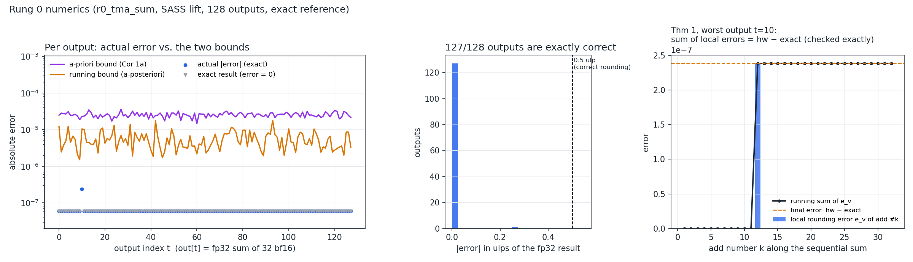

# Rung 0: one TMA, one mbarrier

**Status: done (2026-10-30).** Every exit criterion in ROADMAP rung 0 is met. The one
exception is that witness replay is still manual (`--delay LINE:NS`). Deriving the delays
automatically from a trace is scheduled for rung 1.

## The kernel

`fixtures/r0_tma_sum/kernel.ptx` runs one CTA of 128 threads (4 warps):

```
t0:   mbarrier.init(mbar, 1)                     ; fence.mbarrier_init
all:  bar.sync 0                                 // @B03 deletes this
t0:   mbarrier.arrive.expect_tx(mbar, 8192)      // @B01 says 16384
t0:   cp.async.bulk.tensor.2d  smem <- A[0:64, 0:64] (bf16), complete_tx on mbar
all:  try_wait.parity(mbar, 0)                   // @B02 says parity 1
t:    out[t] = fp32 sequential sum of A[t/2][(t%2)*32 .. +32]
```

The good kernel and each mutant differ by exactly one line, the one carrying the `// @Bxx`
marker. `case.toml` holds the launch description (the stand-in for `.ptxcap` until capture
exists).

## What runs

```bash
source env.sh
cargo build --release
$CARGO_TARGET_DIR/release/ptxv suite fixtures/r0_tma_sum --runs 10000   # everything below
cargo test --release                                                    # regression (CI)
```

For each variant, `ptxv` does the following:
1. writes the variant PTX and compiles it with `ptxas -arch=sm_103a`;
2. **model-checks twice**: once on the PTX, and once on the SASS lifted from the cubin
   (`nvdisasm` → IR). Both runs explore *every* schedule of the launch;
3. on the good variant, **numerics**: one run with exact shadow arithmetic, which records
   every output's exact error, both bounds, and the Thm 1 identity;
4. **hardware**: 10,000 launches on a free GB300 in a child process guarded by a watchdog,
   compared bitwise with the simulator. This is done twice: once normally, and once with
   every SM's shared memory poisoned before each launch (`--scrub`).

## Results

| variant | bug | ptxv verdict (PTX = SASS) | states explored (PTX/SASS) | GB300, 10k launches | GB300, smem scrubbed |
|---|---|---|---|---|---|
| good | — | clean, deterministic (1 distinct output) | 2,611 / 2,400 | **bitwise = simulator** 10,000/10,000 | bitwise = simulator |
| B01 | `expect_tx(16384)`, but the TMA delivers 8192 B | **deadlock**: all 128 threads blocked in `try_wait`; mbarrier at phase 0 with 0/1 arrivals pending and **8192 tx bytes outstanding** | 683 / 688 | hangs (watchdog) | hangs |
| B02 | waits on parity 1 instead of 0 | **race** (smem read vs. TMA write) **+ deadlock** (late pollers wait for a phase that never comes) **+ violation** (TMA writes after the CTA exited) | 29,315 / 8,816 | **1/10,000 wrong** (only run 0) | **10,000/10,000 wrong** |
| B03 | no `bar.sync` between `mbarrier.init` and other warps' `try_wait` | **race on the mbarrier object** (init not ordered before use) | 2,032 / 3,022 | 0/10,000 wrong | 0/10,000 wrong |

Excerpts from the counterexamples (full traces are in `out/r0_tma_sum/summary.md`):

```
B01  DEADLOCK: [t0-127] blocked at ptx:46 `mbarrier.try_wait.parity... 0`
     mbarrier cta0@smem0x2400: phase 0 pending arrivals 0/1 tx-count 8192 bytes
B02  RACE: read-write race on smem byte 0xc00: t32 at sass:0x0270 `LDS.U16 R4, [R2+UR8]`
     and TMA#0 (issued by t0) at sass:0x01b0 `UTMALDG.2D [UR8], [UR4]` are not ordered
B03  RACE on the mbarrier object at smem 0x2400: t0 at sass:0x0140 `SYNCS.EXCH.64 URZ, [UR9], UR4`
     and t1 at sass:0x0200 `SYNCS.PHASECHK.TRANS64.TRYWAIT P0, [UR9], R4` are not ordered
```

### What the hardware column teaches

* **B02 passes 9,999 of 10,000 ordinary test runs.** The consumers really do read shared
  memory before the TMA lands. They get the right answer anyway, because shared memory is
  not cleared between launches and the *previous identical launch* left the same tile there.
  The only failing run is run 0. With smem poisoned before each launch, the bug shows up
  10,000/10,000. A fixed-input test loop would have shipped this bug.
* **B02's hang mode never happens naturally** (the TMA is fast), but ptxv predicted it.
  **Witness replay** reproduces it on hardware: `ptxv hw ... --variant good,B02 --delay
  46:200000` inserts `nanosleep` before the poll. The good kernel still matches bitwise
  (100/100), and B02 hangs.
* **B03 never misbehaves on hardware** in 10,000 runs, with or without scrubbing. It is
  still undefined behavior under the PTX memory model, and ptxv flags it on every schedule.
  This is the class of bug that only a checker finds.

## Numerics



These come from the SASS lift. The PTX lift gives
identical results, and both simulations agree bitwise with each other and with the GB300.

| check | result |
|---|---|
| fp_noise **Thm 1** (`hw − exact == Σ e_v`, checked in exact arithmetic) | holds for all 128 outputs |
| dataflow matches the **spec** (exact value of the kernel's algorithm == exact Σ of the intended 32 inputs, computed independently from the input buffer) | all 128 |
| **Cor 1a** a-priori bound never violated | ✓ (on average 95× above the actual error) |
| running (a-posteriori) bound never violated | ✓ |
| max error | 2.4e-7 = 0.25 ulp |

**Finding: 127 of the 128 outputs are exactly correct.** A bf16 value has an 8-bit
significand, so fp32's 24-bit accumulator can hold a sum of 32 of them exactly until the
partial sums span about 16 bits of dynamic range. Both bounds assume worst-case rounding at
every add, so they cannot see this. It is the discrete-residual effect from fp_noise
(Cor 1d / JOURNAL Finding 1), and it motivates a **grid-aware bound** that proves which adds
are exact. That bound is planned for the N2 work.

## What was validated, and what is assumed

Validated by bitwise agreement with GB300 or by PTX/SASS cross-check:
* SASS lowering of `SYNCS.EXCH.64` (mbarrier init with encoded count `(2^20 − n) << 1`),
  `SYNCS.ARRIVE.TRANS64`, `SYNCS.PHASECHK.TRANS64.TRYWAIT` (parity in bit 31),
  `UTMALDG.2D` (implicit UR tuple: smem, mbar, coords; tensor-map pair), the
  `ELECT`/`BRA.U.ANY` issue loop, `VOTEU`, `PLOP3`/`LOP3` LUT convention, `SHF`, `LEA`,
  `IMAD(.WIDE)`, `HFMA2` constant materialization (f16 immediates printed high, low), and
  `FADD` (IEEE RN, no FTZ, canonical NaN);
* constant bank: params at `c[0x0][0x380]` (constant0 size − param size), generic param base
  at `c[0x0][0x348]`. Only offset 0 has been exercised so far; a tensor map at a nonzero
  param offset is a rung 1 check;
* TMA tile semantics for an unswizzled 2-D box, and mbarrier phase/tx-count semantics.

Model assumptions (now registered in [ASSUMPTIONS.md](../ASSUMPTIONS.md) as E-SPIN, E-DRF,
E-NANOSLEEP and E-BAR-EXIT; every report lists the IDs it depends on):
* **A-spin (E-SPIN):** a failed `try_wait` blocks the thread until the mbarrier changes. This is sound
  when the failure path is a pure retry loop (true in rung 0 for both front-ends). Since
  2026-10-30 that is checked statically (`spin.rs`); see B49.
* **DRF-SC (E-DRF):** plain loads and stores are not scheduling points, and races between them are
  found by vector clocks. The race shadow is part of the state fingerprint, so state merging
  is sound but larger than necessary. That is why B02 takes 29k states.
* `nanosleep` is a no-op, which is semantically exact (E-NANOSLEEP).
* Barrier arrival counts threads. Exited threads do not count as arrived (reported as
  deadlock; E-BAR-EXIT, unvalidated).

## Performance and next steps

The largest run (B02, PTX) takes 57 s for 29k states. That is acceptable here, but it will
not survive rung 1. Planned work: partial-order reduction (independent splits commute),
warp symmetry, and epoch-based race shadows instead of per-byte vector clocks in the
fingerprint.

Next: **rung 1a**, a tcgen05 single-CTA tile (alloc → mma → commit → ld → dealloc) with
mutants B04–B08, and the first tensor-core arithmetic calibration.
