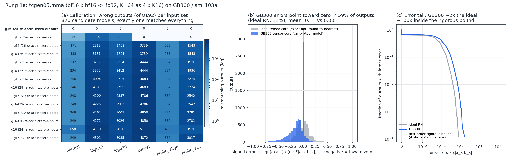

# Rung 1a: a tcgen05 tile (TMEM, MMA, commit, ld) and tensor-core calibration

**Status: done (2026-10-30).** The full tcgen05 pipeline is simulated **bit-exactly** against
GB300, both front-ends agree on every case they should agree on, and all 8 variants get their
expected verdicts. Hardware confirms every prediction it can observe.

## The kernel

`fixtures/r1a_tcgen05_tile/kernel.ptx` computes D[128×64] = A[128×64] · B[64×64]ᵀ (bf16 in,
fp32 accumulate) in one CTA of 4 warps:

```
warp 0 : tcgen05.alloc 64 cols -> smem slot; relinquish_alloc_permit
t0     : init tma_bar, mma_bar
all    : tcgen05.fence::before_thread_sync; bar.sync; tcgen05.fence::after_thread_sync; read TMEM addr
t0     : expect_tx(24576); 2 x 3-D TMA -> no-swizzle K-major core-matrix layout
t0     : wait tma_bar; 4 x tcgen05.mma.kind::f16 (K=16 each; first overwrites D); commit -> mma_bar
all    : wait mma_bar; tcgen05.fence::after_thread_sync; 4 x tcgen05.ld.32x32b.x16 + wait::ld; store row
all    : tcgen05.fence::before_thread_sync; bar.sync; warp 0: fence::after; tcgen05.dealloc
```

Shared-memory descriptors (start, LBO = 2048/1024 B, SBO = 128 B, version 1, no swizzle) and the
instruction descriptor (`0x08100490`: f32 D, bf16 A/B, K-major, N = 64, M = 128) are built in
registers, exactly as real kernels do. The 3-D TMA box `{8, rows, 8}` with strides `{128, 16}`
lands the operands directly in the canonical layout.

## What the SASS revealed (and the lifter now models)

| PTX | SASS (sm_103a) | consequence for verification |
|---|---|---|
| `tcgen05.alloc` | `UTCATOMSWS.FIND_AND_SET.ALIGN` in a `NANOSLEEP` retry loop, plus `ATOMS.OR` bookkeeping in **hidden reserved smem** (0x54/0x58) and a plain `STS` of the address | allocation is partly software. ptxas inserts **guardrail traps** (`BPT.TRAP` in `__cuda_sm10x_tcgen05_guardrail_trap_*`) that the lifter turns into named findings |
| `tcgen05.relinquish_alloc_permit` | `UVIRTCOUNT.DEALLOC.SMPOOL` + a flag byte at smem 0x5c | the alloc path reads this flag (see B16) |
| `tcgen05.dealloc` | bitmap checks against the hidden bookkeeping, then `UTCATOMSWS.AND`, `ATOMS.AND` by one lane (`VOTEU.ANY`/`UFLO`/`REDUX`) | warp-synchronous code: the SASS model gives a converged warp **lockstep ordering** |
| `tcgen05.mma` | `UTCHMMA gdesc[A], gdesc[B], tmem[D], tmem[URx], idesc[URy], UPT\|!UPT` in an `ELECT` loop | enable-input-D is the last predicate |
| `tcgen05.commit` | `UTCBAR [mbar], URZ` | |
| `tcgen05.ld` + `wait::ld` | `LDTM.x16`. **No wait instruction**: register scoreboards order the uses (LDTM sets SB1; the next instruction waits on SB1) | the SASS front-end **checks** the scoreboards ([sass-ctrl.md](sass-ctrl.md)); B44/B45 are binary-patched counterexamples |
| `tcgen05.fence::*` | nothing / a `NOP` (a scheduling constraint for ptxas) | |
| `mbarrier.init` on a divergent path | **plain `STS.64`** of the encoded state word + `SYNCS.CCTL.IVALL` | the simulator decodes mbarriers from memory too |

## Tensor-core calibration

`ptxv calib-mma fixtures/r1a_tcgen05_tile` runs the kernel on GB300 with six input
distributions (normal, log-uniform 2^±12 and 2^±30, cancellation-heavy, an alignment probe, an
accumulator probe). It then scores **820 candidate arithmetic models**:
- group size ∈ {1, 2, 4, 8, 16};
- kept alignment bits ∈ {exact, 23–32};
- final rounding ∈ {RN, RZ};
- accumulator inside or outside the alignment;
- truncation toward zero or toward −∞;
- alignment by the product's exponent or by eₐ+e_b.

Every candidate is checked bit for bit on all 49,152 outputs.

**Exactly one candidate matches every output:** `g16-f25-rz-accin-tzero-einputs`. One
`tcgen05.mma.kind::f16` step (bf16 × bf16 → fp32) on sm_103a works as follows:
1. Take all 16 products **and** the fp32 accumulator, and find the largest alignment exponent,
   using eₐ + e_b (from the input exponent fields, *before* product normalization) for the
   products.
2. Truncate every term **toward zero** to 25 bits below that exponent.
3. Add them exactly, and **round the sum toward zero** to fp32.

The two refinements that made it unique (eₐ + e_b alignment and sign-magnitude truncation) took
the best model from 85–99% agreement to 100%. This is now the simulator's default
(`fp::DEFAULT_MMA`). With it, the whole kernel matches GB300 **bitwise on 1,000/1,000 launches**.



- **(a)** wrong outputs per input set for the 14 best candidates.
- **(b)** GB300's errors point **toward zero in 59% of outputs** (mean −0.11 u·Σ|aₖbₖ|). An
  ideal round-to-nearest tensor core does that in 33% of outputs (mean 0.00). Truncation plus RZ
  gives a *biased* accumulator: errors add up coherently over long K instead of averaging out
  (fp_noise THEORY Cor 1c, RZ bias term).
- **(c)** the error tail on its natural scale (u·Σ|aₖbₖ|) is about 2× the ideal tensor core's,
  and about 100× inside the rigorous first-order bound derived from the model (4 steps × eps).

Numerics, good kernel, both front-ends:
- **Thm 1 holds exactly** for all 8,192 outputs. Each MMA step is a 17-ary rounding node, and
  its local error is recorded exactly.
- Every output's exact value equals the independent `gemm_tn` spec.
- The Cor 1a-style bound (with the model's ε) is never violated. It is loose (mean 1,290× above
  the actual error) because it is worst case per term. Tightening it is N2 work.

## Results

| variant | bug | ptxv PTX | ptxv SASS | GB300 (1,000 launches; same with smem scrubbed) |
|---|---|---|---|---|
| good | — | clean (736 states) | clean (4,958 states) | **bitwise = simulator** |
| B05 | no `tcgen05.wait::ld` before using the registers | **violation**: register read before wait | clean | bitwise correct: PTX UB that this ptxas compiles safely (scoreboards) |
| B06 | no `tcgen05.fence::after_thread_sync` after the mbarrier wait | **race**: MMA's TMEM write vs. `tcgen05.ld` | clean | bitwise correct: PTX UB; the fence is only a `NOP` |
| B07 | no `bar.sync` before warp 0's dealloc | **race** (dealloc vs. other warps' `tcgen05.ld`) + reads of deallocated TMEM | same | bitwise correct: the race never manifests (freed TMEM keeps its data) |
| B41 | no dealloc (TMEM leak) | **violation**: columns still allocated at exit | same | **driver error "tensor memory not completely freed"** |
| B42 | first MMA accumulates into uninitialized TMEM | **violation**: accumulate into never-written TMEM | same | **999/1,000 wrong, all different**: each launch adds onto the previous launch's TMEM |
| B16 | `tcgen05.alloc` by thread 0 only | **violation**: `.sync.aligned` from a partial warp | **race + trap + deadlock** (see below) | **hangs** |
| B43 | commit arrives on the TMA mbarrier | **deadlock** | **deadlock** | **hangs** |
| B44 | *binary only:* the SB1 wait before the first use of LDTM's registers is cleared | clean (PTX is the good kernel) | **violation**: scoreboard RAW, R36 read by `STG` at 0x0a90 while LDTM (SB1) may be outstanding | bitwise correct 1,000/1,000: the STG's operand read queues behind LDTM in the memory pipe |
| B45 | *binary only:* the first LDTM loses its write scoreboard | clean | **violation**: variable-latency result with no scoreboard (+ WAW with the later LDTM into R36) | bitwise correct 1,000/1,000 (same reason) |

### Findings worth reading

* **PTX vs. SASS disagreement is a feature (B05, B06).** These are undefined behavior under the
  PTX memory model, so the PTX front-end reports them. The SASS front-end proves *this binary*
  safe, and hardware agrees. Since the scoreboard check, "SASS clean" for B05 is a proof and no
  longer a trust assumption: ptxas made the uses wait on LDTM's scoreboard anyway, and B44/B45
  show the check fails when it does not. A future ptxas could exploit the UB; the report tells the kernel
  author both facts.
* **B16 on hardware is a ptxas-generated race.** With the alloc reached by only thread 0,
  ptxas emits two paths for one warp:
  - lanes 1–31 run `relinquish_alloc_permit`, which sets the hidden flag at smem 0x5c;
  - thread 0's alloc path reads that flag and traps if it is set.

  ptxv, working from the binary alone, found the race on 0x5c, the guardrail trap
  (`guardrail_trap_phase_invalid_during_alloc`), and a deadlock: thread 0 falls through to a
  second `WARPSYNC.ALL` while lanes 1–31 wait at `BAR.SYNC`. **The GB300 hangs**, which is the
  deadlock path.
* **B42 is invisible to fixed-input testing only on run 0.** TMEM starts at zero, so the first
  launch is correct. Every later launch accumulates onto the last one.
* **B41 is the one bug the driver catches itself.** ptxv reports the same leak statically, with
  the exact columns.

## Modeling decisions introduced in this rung

* **Scheduling points are now only operations that block or touch shared synchronization
  state.** These are barriers, mbarriers, the TMEM allocator, atomics, warp sync, exit and trap.
  Loads and stores (including `tcgen05.ld`), fences, and *issuing* TMA/MMA run eagerly; their
  completions are separate choices. Justified by DRF-SC: races among the eager accesses are
  still found by vector clocks.
* **Canonical state.** Sparse vector clocks, deterministic actor IDs (thread, tcgen05.ld/st
  actor, tcgen05 pipe, TMA by issuer and serial), and sorted reader/arrival/pending lists.
  Commuting steps now reach identical fingerprints. Rung 0's worst case went from 29,315 states
  / 57 s to 1,185 / 1.7 s.
* **tcgen05 ordering (PTX front-end):** `tcgen05.ld` executes as a per-thread actor whose view
  advances only at `tcgen05.fence::after_thread_sync`; `fence::before_thread_sync` releases it.
  MMAs and commits share an in-order pipe per issuing thread, and a commit releases every earlier
  op of that pipe. *Confidence: medium.* The rule follows the PTX ISA's tcgen05 memory-model
  examples. A litmus campaign to probe it on hardware is still TODO (README §7.2).
* **`.sync.aligned` instructions are convergence points** (ptxas emits `WARPSYNC` before them).
  A guarded-off lane still counts as a partial-warp execution.
* **SASS lockstep:** lanes executing together in a converged split are ordered by instruction
  (ptxas's own warp-synchronous code depends on it). PTX lanes stay independent threads.
* **TMEM** is modeled per CTA (one SM) as 128 lanes × 512 columns, with per-word race shadow and
  state (unallocated / allocated-unwritten / written), plus the 16-unit allocator bitmap.
  Allocation blocks while it cannot succeed.

## Limits

* The MMA model is calibrated only for `kind::f16` with bf16 inputs, an fp32 accumulator,
  M = 128, no-swizzle K-major operands, and finite normal values. Subnormal/Inf/NaN inputs, fp16
  inputs, `kind::f8f6f4`/block-scaled kinds, swizzled layouts, `cta_group::2` and other shapes
  are not modeled yet, and the simulator says so instead of guessing. (Since the
  assumption audit this is enforced: subnormal/Inf/NaN MMA inputs or accumulators give an
  `unmodeled` finding. Before the audit they went silently through the model; see N-MMA in
  [ASSUMPTIONS.md](../ASSUMPTIONS.md).)
* TMEM shapes other than `32x32b`, `tcgen05.st/cp/shift`, and multi-CTA TMEM contention
  (residency) are still TODO (rungs 1b/1c).
* The B07 race could not be made visible on hardware (freed TMEM keeps its data). Witness replay
  for TMEM races needs a second allocation to reuse the columns; that is for rung 1b.

Next: **rung 1b**, a persistent S-stage TMA↔MMA pipeline with 128B-swizzled operands, an
epilogue through smem + TMA store (B04: missing `fence.proxy.async`), and the pipeline bugs
B09–B11 (parity after wraparound, missing empty-arrive, TMEM accumulator reuse).
