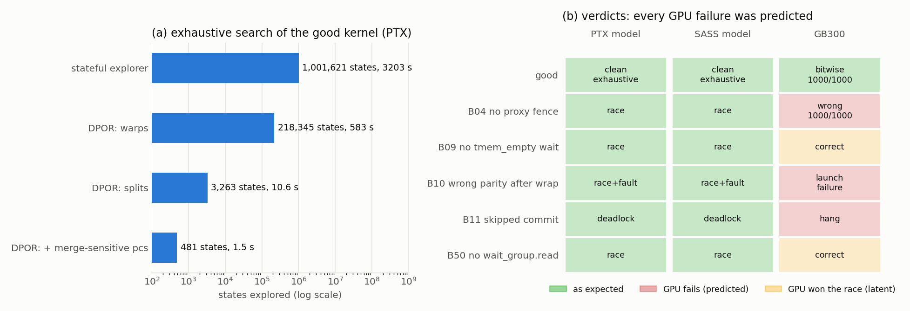

# Rung 1b: a persistent, warp-specialized TMA ↔ tcgen05 pipeline

**Status: done (2026-10-30).**
- The good kernel is explored **exhaustively** on both front-ends and is clean.
- The PTX model, the SASS model and GB300 agree **bitwise** (1000/1000 runs, shared memory
  scrubbed).
- All 5 mutants get their expected verdicts on both front-ends.
- Every hardware failure (wrong output, launch failure, hang) is one the model predicted.

The new DPOR explorer (partial-order reduction, below) makes exhaustive exploration take
1.5 s instead of 53 minutes.

## The kernel

`fixtures/r1b_pipeline/kernel.ptx` computes D[256×16] = A[256×128] · B[16×128]ᵀ (bf16 in,
fp32 out). One CTA of 6 warps covers 2 tiles of 128×16, with K in 2 k-blocks of 64. There are
2 shared-memory stages (128B-swizzled TMA loads, SWIZZLE_128B MMA descriptors) and one TMEM
accumulator reused across tiles. The epilogue goes through shared memory and a TMA store.

```
warp 0 lane 0 (producer)  for i = 0..3: wait empty[s] (parity of round i/2) ; expect_tx full[s] ; 2 x TMA -> stage s
warp 1 lane 0 (MMA)       per tile: wait tmem_empty ; per k-block: wait full[s] ; 4 x tcgen05.mma ; commit -> empty[s]
                          commit -> tmem_full
warps 2-5 (epilogue)      per tile: wait tmem_full ; tcgen05.ld ; arrive tmem_empty ; bar 1 ; st.shared ;
                          fence.proxy.async ; bar 1 ; thread 64: TMA store, commit_group, wait_group.read 0
warp 1                    wait the last tmem_empty phase ; tcgen05.dealloc
```

Six mbarriers: `full[2]`, `empty[2]`, `tmem_full`, `tmem_empty` (count 128). Phase parity is
derived from the iteration counter, so the stages wrap: iteration 2 reuses stage 0 and waits
for its *second* phase. Most pipeline bugs live there.

## Verdicts



| variant | bug | PTX model | SASS model | GB300 (1000 runs, scrubbed) |
|---|---|---|---|---|
| good | | clean, **exhaustive** (481 states) | clean, **exhaustive** (6,060 states) | bitwise = both models |
| B04 | no `fence.proxy.async` between the epilogue's `st.shared` and the TMA store | race (proxy) | race (proxy) | **wrong 1000/1000, 61 distinct outputs** |
| B09 | MMA warp starts tile 1 without waiting for `tmem_empty` | race (TMEM) + its consequences | same | correct (the epilogue wins the race) |
| B10 | producer ignores the round: empty-slot parity is wrong after the stages wrap | race (TMA over a stage the MMA reads) + fault (mbarrier over-arrival) | same | **unspecified launch failure** |
| B11 | MMA warp skips the empty-slot commit on the last k-block of a tile | deadlock | deadlock | **hang** (watchdog) |
| B50 | TMA store issuer does not `wait_group.read` before the buffer is reused | race + nondeterministic (9 outputs) | race + nondeterministic | correct (the store wins the race) |

* B09 and B10 are found within a bounded search (20k states in the tests). Their state space
  explodes *after* the bug fires: corrupted states multiply. `Verdict::meets` makes the rule
  explicit:
  - a **complete** exploration must produce exactly the expected classes;
  - an **incomplete** one passes only for a bug variant, and only once every expected class
    was found;
  - "clean" always requires completeness. The old rule printed `PASS … [clean] … INCOMPLETE`;
    that is gone.
* B04 is the hardware evidence for **S-PROXY**: without the fence, the TMA store reads stale
  shared memory in every run. S-PROXY is now *validated* in the necessity direction
  (ASSUMPTIONS.md).
* B10's launch failure matches the model's fault. Arriving on an mbarrier whose pending count
  is already 0 is not silently tolerated by the hardware.

## What the SASS revealed (and the lifter now models)

| PTX | SASS (sm_103a) | model |
|---|---|---|
| `cp.async.bulk.tensor.2d.global.shared::cta.bulk_group` | `UTMASTG.2D [URa], [URb]` (URa = smem source, then coordinates) inside a `R2UR P, UR, R` + `BRA.U.ANY` uniformization loop | `TmaStore` |
| `cp.async.bulk.commit_group` | `UTMACMDFLUSH`, with a **read scoreboard** (SB0) | `BulkCommit` |
| `cp.async.bulk.wait_group.read 0` **and** `wait_group 0` | the same `DEPBAR.LE SB0, 0x0` on the flush's read scoreboard; the final one is followed by `CCTL.IVALL` | `BulkWait` (E-ASYNC-STEP: both forms are one wait) |
| `mbarrier.arrive` (no tx) | `SYNCS.ARRIVE.TRANS64.A1T0 RZ, [mbar], RZ` | `MbarArrive` |
| `fence.proxy.async.shared::cta` | `MEMBAR.ALL.CTA` + `FENCE.VIEW.ASYNC.S` | fence (S-PROXY) |
| `bar.sync 1, 128` | `BAR.SYNC.DEFER_BLOCKING 0x1, 0x80` | counted barrier |
| 16 × `st.shared.b32` | 4 × `STS.128` | 128-bit stores |

`R2UR P, URd, Ra` is ptxas's way to issue a uniform-datapath op once per distinct value among
the active lanes. URd takes the first active lane's value, and P = "this lane's value
differs", which keeps the lane in the loop. That is the only polarity under which the
single-lane loop in this kernel exits.

**A model bug the differential run caught.** The SASS model stored `STS.128` as a 64-bit
value. The low 8 bytes were written twice, so the output had words repeated in pairs
`[a, b, a, b]`. The PTX model and GB300 agreed with each other and disagreed with the SASS
model, which pointed straight at it. Wide stores now take one register per word, and so does
the numerics provenance of the stored words.

## Exhaustive exploration: DPOR

The stateful explorer needs 1,001,621 states and 53 minutes for this kernel. The new explorer
(`crates/sim/src/dpor.rs`, `PTXV_EXPLORER=dpor`) is **dynamic partial-order reduction**
(Flanagan–Godefroid) with sleep sets. It explores one schedule per Mazurkiewicz trace instead
of one per interleaving. Two transitions are dependent when their recorded footprints
conflict.

What made it tractable here, in order:

| step | idea | good kernel (PTX) |
|---|---|---|
| stateful explorer | every interleaving, state hashing | 1,001,621 states, 3,203 s |
| DPOR, warps as processes | footprints with release/acquire sync keys: barriers and mbarrier phases order transitions without making them conflict | 218,345 states, 583 s |
| + blocked warps acquire their barrier | a warp released by the last arrival acquires the barrier on its next step; without this, `mbarrier.init` looked independent of a warp parked behind `bar.sync` | (same run; it removed the top backtrack cause) |
| DPOR, **splits** as processes | lanes of a warp that diverged (lane 0 producing, lanes 1–31 waiting) are independent processes; a split's program order is the union of its threads' histories | 3,263 states, 10.6 s |
| merge-sensitive pcs only | two splits of a warp *merge* when one reaches the other's pc. That changes what executes only at warp-collective instructions (`.aligned`, `elect`, vote, redux) in PTX, and anywhere in SASS (E-LOCKSTEP). The warp's pcs are a footprint resource exactly there | **481 states, 1.5 s** |

Soundness checks:
* `tests/fixtures.rs` runs both explorers on every smaller fixture and requires identical
  verdicts and identical sets of outputs.
* Two bugs were found this way during the rung. Both are fixed:
  - a faulting step returned before recording its footprint, so DPOR never tried the order
    that avoids the fault (B10 at first explored 51 states and missed the race). A faulting
    step now conflicts with everything;
  - the warp-level process identity hid divergent lanes' independence (a performance issue,
    not a soundness one).

Per-state cost is now dominated by executing transitions (byte-granular shadow memory for
16 KB TMA boxes), not by DPOR bookkeeping.

## Assumptions touched

* **S-PROXY** argued → **validated** (B04 on GB300).
* **E-ASYNC-STEP**: `wait_group.read` = `wait_group`. SASS agrees that there is a single wait.
* **L-ROSETTA**: new forms listed above, validated by the bitwise three-way agreement.

## Reproduce

```
PTXV_EXPLORER=dpor ptxv check fixtures/r1b_pipeline            # all variants, both fronts
ptxv hw fixtures/r1b_pipeline --scrub                          # GB300 (free GPUs only)
cargo test --release --test fixtures r1b                       # 6 tests, ~90 s
python3 tools/plot_r1b.py -o docs/img/r1b.png
```
