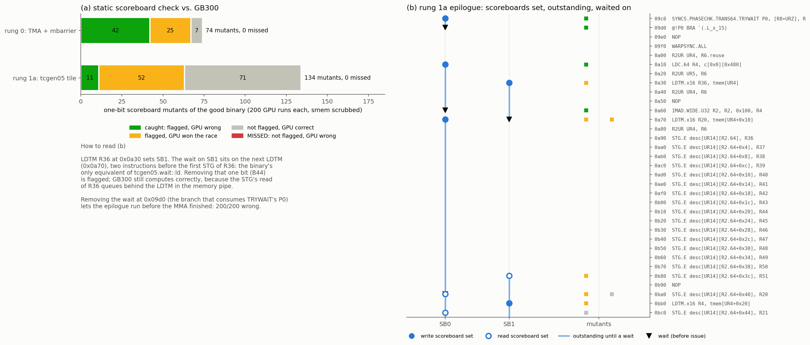

# SASS control bits: verifying scoreboards instead of trusting them

**Status: done (2026-10-30).** The SASS front-end decodes every instruction's scheduling
control word and checks register hazards statically, on every CFG path. A one-bit mutation
sweep over two kernels (208 mutants, 200 GB300 runs each) found **no hardware failure the
check missed**.

## Why this was a gap

On Volta and later GPUs, a register written by a **variable-latency** instruction (LDS, LDG,
LDC, `LDTM`, S2R, SYNCS, ...) has no hardware interlock. The compiler tags the producer with
a scoreboard (SB0–SB5) and puts a *wait* on that scoreboard on or before the first instruction
that touches the register. That is the whole mechanism. `tcgen05.wait::ld` compiles to **no
instruction at all**: the binary's only equivalent is one bit in the control word of a later
instruction.

Until now the SASS front-end assumed those bits were correct. So "B05 is clean on SASS"
meant "if ptxas got the scoreboards right". Now it is checked.

## The control word (sm_100a / sm_103a)

Each instruction is 128 bits; bits [105, 128) of the encoding (`hi >> 41` of the high 64-bit
word printed by `nvdisasm -hex`) are:

| bits of `hi >> 41` | field | meaning |
|---|---|---|
| [0, 4) | stall | cycles before the next instruction may issue (fixed-latency hazards) |
| 4 | yield | |
| [5, 8) | wbar | scoreboard set at issue, released when the results are written (7 = none) |
| [8, 11) | rbar | scoreboard released once the source operands have been read (7 = none) |
| [11, 17) | wait | scoreboards that must drain **before this instruction issues** |
| [17, 21) | reuse | operand reuse cache |

This is the Volta–Hopper layout, and Blackwell keeps it. Evidence from the rung 1a binary:

```
0490 LDS R6, [R6]                   wr=SB2
04a0 R2UR UR13, R6                  wait=[SB2]        <- first use of R6
09c0 SYNCS...TRYWAIT P0, [R8], R5   wr=SB0
09d0 @!P0 BRA                       wait=[SB0]        <- first use of P0
0a30 LDTM.x16 R36, tmem[UR4]        wr=SB1
0a70 LDTM.x16 R20, tmem[UR4+0x10]   wait=[SB1] wr=SB0 <- the binary's tcgen05.wait::ld
0a90 STG.E [R2.64], R36                               <- first use of R36
0b80 STG.E [R2.64+0x3c], R51        rd=SB1            <- read scoreboard for the whole STG burst
```

`DEPBAR.LE SBk, n` waits until at most n operations are outstanding on SBk.

## The check (`crates/sass/src/scoreboard.rs`)

A forward dataflow fixpoint over the whole CFG: every path, including the guardrail-trap
functions reached by `CALL`/`RET`, independent of the launch grid and of predicate values.
At each program point the state is the set of operations that may be outstanding. Each one
records the registers it may still own and a lower bound on how many newer operations were
issued on its scoreboard (used by `DEPBAR.LE`). The join is union / min, which makes it a
finite lattice, so the fixpoint converges in milliseconds.

Reported as `violation` findings, next to the model checker's findings:

| finding | condition |
|---|---|
| **RAW** | register read while a variable-latency write of it may be outstanding |
| **WAW** | register written while such a write may be outstanding |
| **WAR** | register written while a scoreboarded read of it may be outstanding |
| **WAR (untracked)** | register written while an asynchronous read with no read scoreboard (and none on a later read) may be outstanding |
| **no scoreboard** | variable-latency result read when the producer has no write scoreboard |

The rules for *when* operands are read came from the sweep (below). Each was forced by a
hardware counterexample or a false positive:

1. **Memory-pipe instructions read vector-register operands late.** `LDS R5, [R2+…]` with
   `rd=SB0`: remove that bit, and the following `LDC.64 R2` overwrites the address before the
   LDS reads it. That is an *illegal memory access* on GB300, and the first version of the
   check missed it.
2. **These reads happen in issue order.** ptxas puts a read scoreboard only on the last STG of
   a burst. An untracked asynchronous read is attached to the next read that has a read
   scoreboard; it is also released when its own instruction's write scoreboard is waited on.
3. **Vector instructions read uniform operands at issue**, with or without a read scoreboard.
   `LDTM tmem[UR4]` is followed immediately by `R2UR UR4, …` with no wait (6 false positives
   before this rule); in rung 1c ptxas overwrites the `desc[UR6]` of an `STG` that has
   `rd=SB0` with no wait.
   Uniform-unit instructions (UTMALDG, UTCHMMA, …) read their URs late.
4. **Guard predicates are consumed at issue**, so read scoreboards never cover them (2 false
   positives on the rung 0 binary before this rule).

## Validation: one-bit mutation sweep on GB300

`ptxv sb-sweep <case> --runs 200` removes each scoreboard bit of the good binary in turn: one
wait bit, or one wbar or rbar. Each mutant goes through the static check and then runs 200
times on a free GB300 with shared memory scrubbed, three GPUs in parallel.




| kernel | mutants | caught | flagged, GPU won | not flagged, GPU correct | **missed** |
|---|---|---|---|---|---|
| r0 TMA + mbarrier | 74 | 42 (38 wrong outputs, 4 illegal address) | 24 | 8 | **0** |
| r1a tcgen05 tile | 134 | 11 (2 wrong outputs, 9 illegal address / launch failure) | 51 | 72 | **0** |

*(Re-scored 2026-10-30 after rule 3 was extended to instructions with a read scoreboard, see
rung 1c: one mutant per kernel moved from "flagged, GPU won" to "not flagged", the SB0 wait
before an `LDCU.64 UR4` that overwrites the `desc[UR4]` of an earlier `STG`. GPU correct
200/200 in both. Still 0 missed.)*

* **Soundness evidence:** every mutant that ever misbehaved on hardware is flagged. This is
  evidence, not proof: an unflagged mutant could still fail under a timing the 200 runs never
  produced.
* **"Flagged, GPU won"** (75) are real contract violations whose latency happened to be
  covered. Examples: the LDTM mutants (B44/B45 below) and WAWs on spin-loop predicates. A
  different clock, contention, or a future chip can lose these races.
* **Not flagged, GPU correct** (80) are almost all one of these:
  - read scoreboards made redundant by in-order reads (47 STG `rd` bits whose burst has a
    later `rd`);
  - waits that guard **memory ordering, not registers**: `BAR`/`EXIT`/`BRA`/`CALL` waiting on
    `FENCE` or `SYNCS` completion, and `FENCE`'s own `wr`.

  The second kind is outside a register check by design. It is the memory model's job; see
  limits.

### Binary-only fixtures

Two mutants are now permanent fixtures in `fixtures/r1a_tcgen05_tile`. Their PTX is the good
kernel, and a `patch = [{ at = ..., wait/wbar/rbar/stall = ... }]` edits the cubin after
`ptxas`:

| variant | edit | PTX front | SASS front | GB300 |
|---|---|---|---|---|
| B44 | clear the SB1 wait at 0x0a70 | clean | **violation**: `SCOREBOARD RAW: R36 read at 0x0a90 STG while LDTM (SB1) may be outstanding; also at 0x0aa0 … 0x0b80` | correct 1,000/1,000 |
| B45 | first LDTM gets no write scoreboard | clean | **violation**: no scoreboard (+ WAW with the later LDTM into R36) | correct 1,000/1,000 |

Why GB300 survives B44: shrinking the intervening stall counts until only 6 issue cycles
separate LDTM from the STG still gave 0/200 wrong. The most likely explanation is that the
STG's operand read queues behind LDTM in the same memory pipe. An ALU consumer of R36 would
have no such protection. This is a hypothesis; a fixture with an FADD consumer would test it.

## What stays trusted (README §9)

* **Fixed-latency hazards.** Stall counts are not checked; that needs a per-opcode latency
  table. A sweep over stall fields is the natural next validation.
* **The operand-read rules above.** They are validated by the sweep, not by documentation.
* **Scoreboards that order memory, not registers** (FENCE completion, SYNCS before BAR or
  EXIT). The memory model handles those semantically; it does not yet check that the binary
  waits for them.
* **Opcode classes:** the variable-latency set (`VAR_LAT`) and the asynchronous-reader set
  (`ASYNC_READ`). An opcode outside them that needs a scoreboard would be missed. On the
  corpus, every opcode ptxas ever gave a scoreboard is in the sets.
